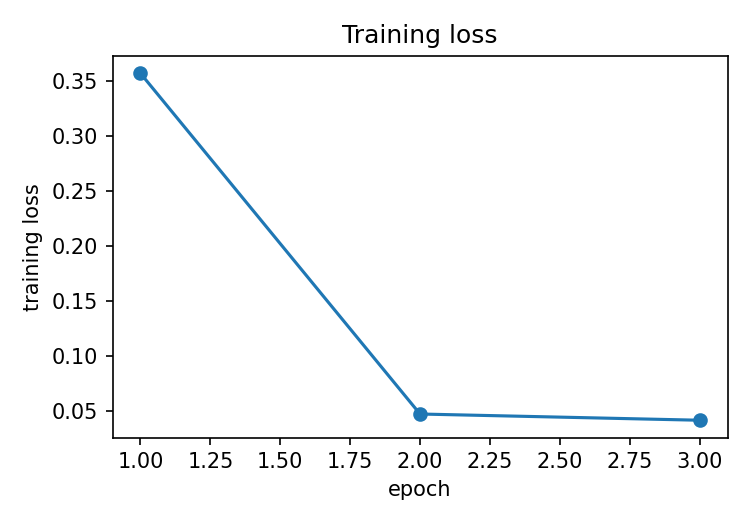

# Prescription Chatbot

Handwritten medicine name recognition using a fine-tuned TrOCR model, with a Streamlit chatbot that answers basic questions about the recognised medicine.

## Live Demo

🔗 **[Try it here](https://prescription-chatbot-dwawe45ggknftzrcimy7wq.streamlit.app/)**

Upload a cropped image of a single handwritten medicine name. Sample images are in the `test_samples` folder.

## Model

Fine-tuned model on Hugging Face: [Avni2028/trocr-prescription-bd](https://huggingface.co/Avni2028/trocr-prescription-bd)

## Results (test set, 780 images)

| System | Word accuracy % | CER % |
|---|---|---|
| Tesseract | 4.36 | 63.46 |
| Pretrained TrOCR | 12.44 | 58.56 |
| Fine-tuned TrOCR | 93.21 | 4.33 |
| Fine-tuned TrOCR + correction | 94.1 | 4.35 |

## Dataset

Doctor's Handwritten Prescription BD dataset (Kaggle: `mamun1113/doctors-handwritten-prescription-bd-dataset`). 4,680 images, 78 medicine classes (3,120 train / 780 validation / 780 test).

## Files

- `prescription_ocr.ipynb`: full pipeline (preprocessing, Tesseract baseline, TrOCR fine-tuning, correction)
- `app.py`: Streamlit chatbot (loads the model from Hugging Face)
- `drug_list.csv`, `drug_info.json`: medicine list and info used by the chatbot
- `results.json`: evaluation results
- `test_samples/`: one test image per medicine, named by its true label
- `requirements.txt`: Python packages

## How to run

**Online:** use the live demo link above.

**Locally:**

    git clone https://github.com/Avni2027/prescription-chatbot.git
    cd prescription-chatbot
    pip install -r requirements.txt
    streamlit run app.py

**Retrain:** open `prescription_ocr.ipynb` in Google Colab with a GPU runtime and run the cells in order.

## Limitations

- Works on cropped images of a single handwritten medicine name, not full prescription pages.
- Recognises only the 78 medicines in the dataset.
- The "confidence" shown is a spelling-match score against the drug list, not the model's certainty.
- The chatbot answers generic names from the dataset. Other fields in `drug_info.json` are placeholders, so it may say it has no information.

## Disclaimer

Demo project only. Always confirm with a doctor or pharmacist. No dosage advice is given.
