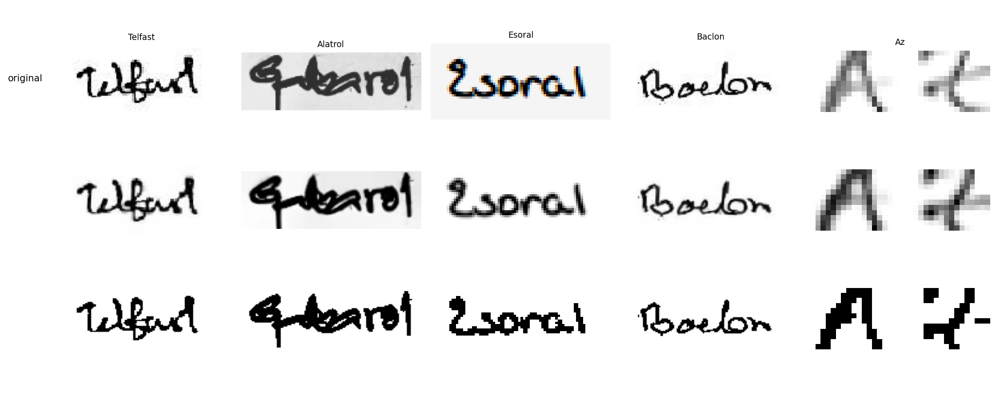

# Prescription Chatbot

Handwritten medicine name recognition using a fine-tuned TrOCR model, with a Streamlit chatbot that answers basic questions about the recognised medicine.

## Results (test set, 780 images)

| System | Word accuracy % | CER % |
|---|---|---|
| Tesseract | 4.36 | 63.46 |
| Pretrained TrOCR | 12.44 | 58.56 |
| Fine-tuned TrOCR | 93.21 | 4.33 |
| Fine-tuned TrOCR + correction | 94.1 | 4.35 |

## Dataset

Doctor's Handwritten Prescription BD dataset (Kaggle: `mamun1113/doctors-handwritten-prescription-bd-dataset`). 78 medicine classes.

## Files

- `prescription_ocr.ipynb`: full pipeline (preprocessing, Tesseract baseline, TrOCR fine-tuning, correction)
- `app.py`: Streamlit chatbot
- `drug_list.csv`, `drug_info.json`: medicine list and info used by the chatbot
- `results.json`: evaluation results

## How to run

1. Open `prescription_ocr.ipynb` in Google Colab with a GPU runtime.
2. Run the cells in order.
3. The last cells start the Streamlit app. Note that `app.py` uses `/content/work/` paths, so it is designed to run inside Colab.

## Model

The fine-tuned model is not stored here because of its size (about 1.3 GB). Link: (add your Google Drive or Hugging Face link here)

## Limitations

- Recognises only the 78 medicines in the dataset.
- Most entries in `drug_info.json` are placeholders, so the chatbot may say it has no information.

## Disclaimer

Demo project only. Always confirm with a doctor or pharmacist. No dosage advice is given.# prescription-chatbot
